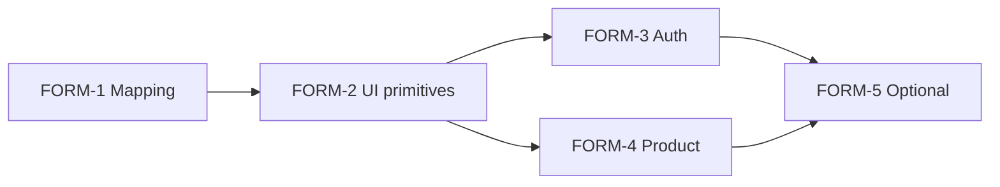

# Form validation & error presentation — phased plan

**Status:** FORM-1–4 complete (2026-11-16); FORM-5 optional / not started.  
**Goal:** One predictable way to validate, map API errors, and show messages on every user-facing form — without replacing Nest as source of truth.  
**Related:** [FRONTEND_CONVENTIONS.md](../FRONTEND_CONVENTIONS.md) §8–9, [AUTH_CONVENTIONS.md](../AUTH_CONVENTIONS.md), backend [PHASE_0_DECISIONS.md](../../backend/docs/PHASE_0_DECISIONS.md) (400 `VALIDATION_ERROR`).

---

## 1. Problem statement (current gaps)

| Gap | Impact |
| --- | --- |
| **`mapAuthFieldErrors` only understands flat `details` objects** | Global pipe returns Zod issues as `{ path: string[], message }[]` ([`configure-app.ts`](../../backend/src/configure-app.ts)). Auth register/login/forgot often show **“Check the highlighted fields”** with **no highlighted fields**. |
| **Two server `details` shapes** | Pipe: **array of issues**. Services (problems, topics): **record** `{ title: "…" }`. One mapper must handle both. |
| **Duplicate / generic form banners** | Top-level `Invalid input.` plus good field copy; or banner-only errors (`EMAIL_IN_USE`, `INVALID_CREDENTIALS`) with no field anchor. |
| **No client preflight** | Users wait on the network for empty login, short password, empty title — then may see poor error placement. |
| **Inconsistent a11y** | Login password / forgot email lack inline errors and `aria-describedby` parity with register. |
| **Hints drift from rules** | UI says “characters”; server uses **Unicode code points** ([`measureCodePoints`](../../backend/src/common/unicode.js)). Password rules under-explained on register/reset. |
| **Ad hoc form state** | Each route repeats `pending`, `formError`, `fieldErrors`, clear-on-submit. |

**Non-goals:** Client-only validation that contradicts the API; exposing `VALIDATION_ERROR` or stack traces; Zod-on-frontend for every endpoint in v1; Felte / TanStack Form unless FORM-4+ proves insufficient.

---

## 2. Target end state

### 2.1 Error pipeline

```
submit → [optional client validate] → API
           ↓ fail
    ApiError (code, message, details)
           ↓
    mapApiFieldErrors(details)  → FieldErrors
    resolveFormBanner(error, fieldErrors) → banner | undefined
           ↓
    FormField + FormAlert UI
```

**Banner rules (normative):**

| Situation | Form banner | Field errors |
| --- | --- | --- |
| Field-level `VALIDATION_ERROR` with mapped fields | **Omit** generic “Invalid input.” / “Check the highlighted fields.” | Show per field |
| `INVALID_CREDENTIALS` | Single sentence (no field split) | Optional: none (security) |
| `EMAIL_IN_USE` | Optional short line | **email** field message preferred |
| Network / 5xx / rate limit | Banner with recovery copy | Clear field errors |
| Business codes (`PROBLEM_URL_IN_USE`, `TOPIC_NAME_IN_USE`) | Banner or inline link CTA | Map when `details` includes fields |

### 2.2 UI building blocks

| Piece | Responsibility |
| --- | --- |
| [`FormField`](../src/components/ui/FormField.tsx) (new) | Label, control slot, hint (`id` for `aria-describedby`), error line, `aria-invalid` wiring |
| [`FormAlert`](../src/components/ui/FormAlert.tsx) (new) | Form-level `role="alert"`; variants: danger, success (register “account created”), rate-limit with optional wait hint |
| [`mapApiFieldErrors`](../src/lib/forms/map-api-field-errors.ts) (new) | Replace / supersede `mapAuthFieldErrors`; unit-tested fixtures for both `details` shapes |
| [`resolveFormBanner`](../src/lib/forms/resolve-form-banner.ts) (new) | Uses existing `authFormMessage`, `problemFormMessage`, `topicFormMessage` + banner rules |
| **Client validators** | Pure functions in `lib/forms/validate-*.ts`; same limits as backend constants |

### 2.3 Copy constants (single source for hints)

| Constant | Backend mirror | Used on |
| --- | --- | --- |
| `AUTH_PASSWORD_HINT` | `passwordSchema` 15–128 code points, spaces OK | Register, reset |
| `AUTH_NAME_HINT` | register name 1–100 after trim | Register |
| Problem/topic hints | Already in [`fields.ts`](../src/lib/problems/fields.ts) + topic name limits | Problem forms, topics |

Prefer importing **numeric limits** from shared modules where the repo already aliases backend shared code (`@platforms` pattern); duplicate prose only when import is awkward.

### 2.4 Forms in scope

| Form | Route / component |
| --- | --- |
| Sign in | [`login.tsx`](../src/routes/login.tsx) |
| Register | [`register.tsx`](../src/routes/register.tsx) |
| Forgot password | [`forgot-password.tsx`](../src/routes/forgot-password.tsx) |
| Reset password | [`reset-password.tsx`](../src/routes/reset-password.tsx) |
| Problem create/edit | [`new.tsx`](../src/routes/app/problems/new.tsx), [`edit.tsx`](../src/routes/app/problems/[id]/edit.tsx), [`ProblemFormFields.tsx`](../src/components/problems/ProblemFormFields.tsx) |
| Topic create/rename | [`topics/index.tsx`](../src/routes/app/topics/index.tsx) |

**Out of scope (v1):** Library browse toolbar (URL sanitization, not a submit form); profile (read-only); dashboard (no forms).

---

## 3. Phase overview

| Phase | Name | Delivers |
| --- | --- | --- |
| **FORM-1** | Error mapping contract **done** | `mapApiFieldErrors`, `resolveFormBanner`, `enrichFieldErrorsFromError`, tests |
| **FORM-2** | Presentation primitives **done** | `FormField`, `FormAlert`, `formFieldControlAttrs`, auth hints, FRONTEND_CONVENTIONS §8.1 |
| **FORM-3** | Auth forms **done** | `validate-auth`, `applyAuthApiError`, all auth routes on FormField/FormAlert |
| **FORM-4** | Product forms **done** | `validate-problem` / `validate-topic`, `applyProductApiError`, `focusFirstInvalid`, product routes |
| **FORM-5** (optional) | Ergonomics | `createFormState` helper, live length feedback, rate-limit `Retry-After` UX |



---

## FORM-1 — API error mapping contract

**Status (2026-11-16):** Done — see [FORM_VALIDATION_PHASED_RESULTS.md](FORM_VALIDATION_PHASED_RESULTS.md). Code in [`src/lib/forms/`](../src/lib/forms/).

**Goal:** Every form can turn `ApiError.details` into `FieldErrors` reliably.

### 1.1 `mapApiFieldErrors(details: unknown): FieldErrors`

Implement in `cp-frontend/src/lib/forms/map-api-field-errors.ts`:

1. **`null` / non-object** → `{}`
2. **Array** (global validation pipe): each issue `{ path: string[], message: string }` → key = `path[0]` (or joined for nested paths if ever needed); first message wins per key.
3. **Record**: reuse current `mapAuthFieldErrors` behavior (string or string[] values).

### 1.2 `resolveFormBanner(error, fieldErrors, domain)`

- **domain:** `'auth' | 'problem' | 'topic'`
- If `Object.keys(fieldErrors).length > 0` and `code === 'VALIDATION_ERROR'`, return **undefined** (fields speak) unless a domain-specific banner is still needed (e.g. duplicate URL with link — keep banner + `existingProblemId` UX).
- Map `EMAIL_IN_USE` → set `fieldErrors.email` in caller **or** inside a small `applyAuthBusinessErrors` helper.

### 1.3 Migration

- `problemFieldErrors` / `topicFieldErrors` → thin wrappers calling `mapApiFieldErrors` (keep exports for stability).
- `mapAuthFieldErrors` → re-export alias with `@deprecated` JSDoc pointing to `mapApiFieldErrors`.

### 1.4 Exit criteria

- [x] Unit tests: pipe-shaped array fixture, record fixture, empty, nested path edge case.
- [x] No route changes required yet — tests + new modules only (`mapAuthFieldErrors` alias delegates to `mapApiFieldErrors`).
- [x] Document `details` shapes in this file § appendix.

### 1.5 Verification

```bash
cd cp-frontend && pnpm exec tsc --noEmit && pnpm test --run src/lib/forms
```

---

## FORM-2 — Presentation primitives & conventions

**Status (2026-11-16):** Done — see [FORM_VALIDATION_PHASED_RESULTS.md](FORM_VALIDATION_PHASED_RESULTS.md). Register/reset use shared auth hints only (full `FormField` migration in FORM-3).

**Goal:** One visual and accessibility pattern for labels, hints, and errors.

### 2.1 `FormField` component

Props (illustrative):

- `id`, `label`, `hint?`, `error?`, `required?`, `children` (input/textarea)

Behavior:

- Error `id={`${id}-error`}`, hint `id={`${id}-hint`}`
- `aria-describedby`: hint only when no error; hint + error when error present
- `aria-invalid="true"` when `error` set
- Classes: match existing `ui-field`, `text-danger`, `text-muted` patterns

### 2.2 `FormAlert`

- `role="alert"` for errors; `role="status"` for success info
- Optional `retryAfter` / humanized wait text for rate limits

### 2.3 Hint constants

- `lib/forms/auth-field-copy.ts`: `AUTH_PASSWORD_HINT`, `AUTH_NAME_HINT` (accurate code-point wording)
- Register and reset import these; remove duplicated strings

### 2.4 Documentation

- Add **§ Form validation & errors** to [FRONTEND_CONVENTIONS.md](../FRONTEND_CONVENTIONS.md): pipeline diagram, banner rules, when to use `noValidate` on `<form>`.

### 2.5 Exit criteria

- [x] Storybook not required; component tests via `@solidjs/testing-library` for `FormField` a11y ids.
- [x] Register + reset use `AUTH_NAME_HINT` / `AUTH_PASSWORD_HINT`; full `FormField` route migration deferred to FORM-3.

### 2.6 Verification

```bash
cd cp-frontend && pnpm test --run src/components/ui/FormField.test.tsx
```

---

## FORM-3 — Auth routes

**Status (2026-11-16):** Done — see [FORM_VALIDATION_PHASED_RESULTS.md](FORM_VALIDATION_PHASED_RESULTS.md).

**Goal:** Auth forms use FORM-1 + FORM-2; passwords and validation failures are understandable.

### 3.1 Client preflight (`lib/forms/validate-auth.ts`)

| Check | Register | Login | Forgot | Reset |
| --- | --- | --- | --- | --- |
| Email trim + non-empty + basic shape | ✓ | ✓ | ✓ | — |
| Password non-empty | ✓ | ✓ | — | ✓ |
| Name 1–100 code points after trim | ✓ | — | — | — |
| Password 15–128 code points | ✓ | — | — | ✓ |
| Confirm matches | — | — | — | ✓ |

Use `codePointLength` from [`forms.ts`](../src/lib/auth/forms.ts) (move to `lib/forms/unicode.ts` if cleaner).

Messages: **same sentences** as backend Zod / `passwordSchema` where possible.

### 3.2 Route changes

- Replace hand-rolled field markup with `FormField` + `FormAlert`.
- Submit: run client validate → if errors, set `fieldErrors`, **no API call**.
- Server error: `mapApiFieldErrors`; `resolveFormBanner`.
- **Register:** clear password only on **success**, not on validation failure (security: still clear on success before redirect).
- **Login:** keep credential banner; add `required` or client empty checks.
- **Forgot:** inline email error paragraph.
- **Reset:** mark confirm field `aria-invalid` on mismatch.

### 3.3 `EMAIL_IN_USE`

Set `fieldErrors.email` + optional short banner.

### 3.4 Exit criteria

- [x] Manual: invalid register (short password) shows field error **before** or **after** submit without empty highlights.
- [x] Manual: Zod invalid email highlights email field.
- [x] E2E: existing `auth-flow` / register tests still pass (adjust selectors only if ids stable).

### 3.5 Verification

```bash
cd cp-frontend && pnpm test --run src/lib/forms src/routes
# optional: pnpm test:e2e e2e/auth-flow.spec.ts
```

---

## FORM-4 — Product forms (problems & topics)

**Status (2026-11-16):** Done — see [FORM_VALIDATION_PHASED_RESULTS.md](FORM_VALIDATION_PHASED_RESULTS.md).

**Goal:** Same pipeline as auth; keep duplicate-URL and topic-in-use affordances.

### 4.1 Client preflight

- `validateProblemDraft` / `validateTopicName`: title/url/topic name rules aligned with [`problem-title.ts`](../../backend/src/modules/problems/problem-title.ts), [`problem-url.ts`](../../backend/src/modules/problems/problem-url.ts), [`topic-name.ts`](../../backend/src/modules/topics/topic-name.ts).
- Rating: if non-empty, must parse as integer in range (avoid silent `NaN`).

### 4.2 Refactor

- [`ProblemFormFields.tsx`](../src/components/problems/ProblemFormFields.tsx): compose `FormField` per control; keep `PlatformMark` / topic checkboxes as custom slots.
- Topics create + rename dialogs/inline forms → `FormField`.
- Server: `mapApiFieldErrors` on all `VALIDATION_ERROR`; suppress generic banner when fields populated.

### 4.3 `focusFirstInvalid()`

After failed client or server validation, focus first `[aria-invalid="true"]` in the form (respect `preventScroll` only on mobile if needed).

### 4.4 Exit criteria

- [x] Create problem: empty URL → inline error without round trip (client).
- [x] Server URL scheme error appears on **url** field, no duplicate generic banner.
- [x] `PROBLEM_URL_IN_USE` still shows link to existing problem.

### 4.5 Verification

```bash
cd cp-frontend && pnpm exec tsc --noEmit && pnpm test --run
```

---

## FORM-5 (optional) — Ergonomics & polish

**Goal:** Less boilerplate and better live feedback.

### 5.1 `createFormState` helper (optional)

Solid-friendly helper: `pending`, `fieldErrors`, `formBanner`, `resetErrors`, `applyApiError(error, domain)` — **not** a third-party form framework.

### 5.2 Live feedback (optional)

- Password/register: “12 / 15 characters” using code points (only after blur or after first submit attempt — avoid noisy `role="alert"` per keystroke).
- Clear per-field error when user edits that field post-failure.

### 5.3 Rate limiting

- Parse `ApiError.retryAfter` / `Retry-After` header into `FormAlert` copy: “Try again in about N minutes.”

### 5.4 Backend alignment (optional, small)

If pipe-shaped `details` remain painful for clients, consider **also** flattening auth validation to a record in `AuthErrorFilter` — **only** if product agrees; FORM-1 should not depend on this.

---

## 4. Cross-cutting concerns

### 4.1 Accessibility

- One primary error mechanism per field: `aria-describedby` includes hint + error ids.
- Form-level alerts for non-field failures only.
- Do not announce every keystroke in live regions.

### 4.2 Security

- Do not loosen login enumeration rules.
- Clear secrets on successful register navigation; consider keeping password on validation failure for usability (document threat model: validation errors are not credential leaks).

### 4.3 Testing strategy

| Layer | What |
| --- | --- |
| Unit | `mapApiFieldErrors`, client validators, `resolveFormBanner` |
| Component | `FormField` a11y attributes |
| Integration | Existing API message tests extended with pipe fixtures |
| E2E | Auth + problem create regression |

### 4.4 Documentation handoff

When each phase completes:

1. Update **Status** row in §3 table.
2. Add `FORM_VALIDATION_PHASED_RESULTS.md` (mirror dashboard results doc) with manual checklist.
3. Tick FRONTEND_CONVENTIONS form section.

---

## 5. Suggested implementation order

| PR / sprint | Work |
| --- | --- |
| 1 | FORM-1 only — mapping + tests, wire problem/topic wrappers |
| 2 | FORM-2 — `FormField` / `FormAlert` + conventions |
| 3 | FORM-3 — auth routes (highest user pain) |
| 4 | FORM-4 — problems + topics |
| 5 | FORM-5 — as needed |

**First PR:** FORM-1 — fixes auth field highlighting when used from FORM-3 with zero UI churn if mapping is imported early in auth routes.

---

## Appendix A — API `details` shapes (reference)

**Global pipe (400 `VALIDATION_ERROR`):**

```json
{
  "code": "VALIDATION_ERROR",
  "message": "Invalid input.",
  "details": [
    { "path": ["password"], "message": "Password must contain 15–128 characters" }
  ]
}
```

**Service layer (problems / topics):**

```json
{
  "code": "VALIDATION_ERROR",
  "message": "Problem URL must use http or https.",
  "details": {
    "url": "Problem URL must use http or https."
  }
}
```

**Business conflict:**

```json
{
  "code": "PROBLEM_URL_IN_USE",
  "message": "You already saved a problem with this URL.",
  "details": { "existingProblemId": "<uuid>" }
}
```

---

## Appendix B — Current files to retire or thin

| File | After FORM-4 |
| --- | --- |
| `mapAuthFieldErrors` in [`forms.ts`](../src/lib/auth/forms.ts) | Alias to `mapApiFieldErrors` |
| Repeated error markup in routes | Replaced by `FormField` / `FormAlert` |
| Unused `codePointLength` | Used by validators + optional live meter |